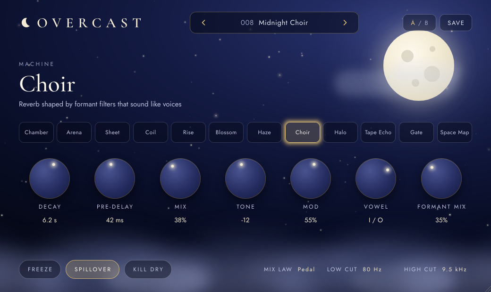

# Overcast

A multi-machine stereo reverb plugin for macOS (VST3 and AU), built with JUCE 8.

**Status: Phases 1 to 4.** All 12 machines are implemented, level-matched and tested.
Switching machines crossfades, and with Spillover on the old tail rings out naturally.
The night sky panel is in: twinkling stars, rare shooting stars and rolling clouds,
a sky of its own for each machine, and a moon that doubles as the bypass switch,
with factory and user presets and A/B compare.

## The panel



- **Knobs:** drag up and down, hold Shift for fine moves, scroll, or double-click to reset.
  Param 1 and Param 2 are relabelled for each machine and show real units (Hz, ms,
  vowels, intervals, tape heads).
- **Low cut, High cut, Mix law:** drag the text up and down, or click Mix law to switch.
- **Presets:** the arrows step through presets, and clicking the name lists them all.
  Save stores your own in `~/Library/Audio/Presets/Overcast Audio/Overcast`.
  A `*` after the name means you've changed it since loading. Hosts also see the
  12 factory presets as programs.
- **A / B:** the first click copies A into B. Tweak B, then click to flip between them.
- **Sky:** each machine has its own sky (Chamber's lantern light, Arena's Milky Way,
  Sheet's frost, Coil's rain, Rise's sunrise, Blossom's rising lights, Haze's mist,
  Aurora's northern lights, Halo's moon halo, Nebula, Clear Night's cloudless sky and
  Space Map's dense stars). Switching machine fades between them over 3 seconds while
  the moon glides to that machine's phase, waxing from a thin crescent on Chamber to
  full on Halo and waning after it. Tone tints the moon: warm cream at centre, white
  at the top, a blood moon at the bottom. Halo's Shimmer adds stars and, near the top,
  glitter; Blossom's Feedback adds lights and rising motes. Freeze stops the twinkling.
- **Bypass:** click the moon. It goes to a new moon, the sky turns black with only
  stars, and the controls dim. Click again to turn Overcast back on. Hosts see the
  same switch as the plugin's bypass, and it fades over 20 ms so it never clicks.
- **Size:** drag the bottom-right corner (70% to 150%). The size is saved with the session.
- **Motion:** the sky animates at 30 fps only while the window is open, and stops
  when macOS Reduce Motion is on (System Settings › Accessibility › Display). With
  Reduce Motion on, sky changes are instant instead of fading.

The fonts are Cormorant Garamond and Jost, embedded from `resources/fonts` under the
SIL Open Font License.

Aurora's reverb core follows Cloud Seed by Ghost Note Audio (MIT licence). Overcast is not
made by or affiliated with Ghost Note Audio; see `THIRD_PARTY_NOTICES.md`.

Halo's shimmer follows ShimmerVerb by Danial Kooshki (MIT licence), around a Zita-Rev1
style network (Fons Adriaensen's design). Overcast is not made by or affiliated with
either; see `THIRD_PARTY_NOTICES.md`.

## Building on macOS

Requirements: Xcode 15 or later (command line tools are enough) and CMake 3.22+.

```sh
cmake -S . -B build -DCMAKE_BUILD_TYPE=Release
cmake --build build --config Release -j
ctest --test-dir build --output-on-failure
```

JUCE and Catch2 are downloaded automatically on the first configure. To use a local
JUCE checkout instead, add `-DOVERCAST_JUCE_DIR=/path/to/JUCE`.

The build produces a universal (Apple Silicon + Intel) VST3, AU and Standalone app in
`build/Overcast_artefacts/Release/`, and copies the VST3 and AU into
`~/Library/Audio/Plug-Ins/` so your DAW can find them. In Logic, rescan with
Settings › Plug-in Manager if Overcast doesn't appear.

To work in Xcode: `cmake -S . -B build-xcode -G Xcode`.

## Layout

```
source/
  PluginProcessor.*   audio callback, parameter tree, state save/load
  PluginEditor.*      the night sky panel and its layout
  PresetManager.*     factory and user presets, A/B compare
  Parameters.*        parameter IDs and ranges (IDs must never change)
  ui/                 sky animation, knobs and buttons, fonts, per-machine labels
  dsp/                plain C++ DSP with no JUCE dependency
    Blocks.h          delay lines, allpasses, filters, smoothers, LFO, limiter
    ReverbMachine.h   the interface every machine implements
    Shared.h          FDN, diffusers, tap delays, antialiased saturation, pitch shifter
    Machines.h        machine list, factory and loudness trims
    machines/         one file per machine
    ReverbEngine.*    machine switching, pre-delay, tone, wet filters, limiter and mix
tests/                Catch2 tests for the DSP
tools/Snapshot.cpp    renders the panel to PNG without a host (development only)
resources/fonts/      embedded fonts and their licences
```

To render the panel to PNG files, configure with `-DOVERCAST_BUILD_SNAPSHOT=ON` and run
`OvercastSnapshot <out-dir> [preset] [seconds] [fps] [scale]`.

## What the tests check

- Dry signal passes through bit-exact at 0% mix, at any buffer size
- Decay time matches the Decay knob (plate, hall and ambient machines)
- Every machine sounds the same at 44.1 and 96 kHz, and is silent for silent input
- Every machine survives 10 seconds of random parameter automation with no blow-ups
- Freeze never makes a tail grow, and holds it on every sustaining machine
- Machines are loudness matched to within 2 dB
- Switching machines, with or without spillover, never clips or produces NaN
- Wet output never exceeds full scale, even with input at +12 dB and Freeze on

CI also runs `auval` and `pluginval` (strictness 10, including its editor tests) on every pull request.

## Parameters

| Parameter | Range |
| --- | --- |
| Machine | 12 choices (see below) |
| Decay | 0.1 to 60 s |
| Pre-delay | 0 to 500 ms |
| Mix | 0 to 100% |
| Tone | -100 to +100 (tilt EQ on the wet signal) |
| Mod | 0 to 100% |
| Param 1 / Param 2 | 0 to 100%, meaning depends on the machine (see below) |
| Low Cut / High Cut | 20 Hz to 1 kHz / 1 to 20 kHz on the wet signal |
| Freeze, Spillover, Kill Dry | on/off |
| Mix Law | Equal power or Pedal (dry stays full up to 50%) |

## Machines

| Machine | Character | Param 1 | Param 2 |
| --- | --- | --- | --- |
| Chamber | Small to medium rooms | Room size | Early / late balance |
| Arena | Large hall | Low decay (0.5x to 2x) | High decay (0.15x to 1x) |
| Sheet | Studio plate | Low end cut | Damping |
| Coil | Spring tank | Springs (1 to 3) | Dwell (drive) |
| Rise | Auto-swell | Rise time (50 ms to 3 s) | Mode: reverb only / reverb and dry |
| Blossom | Tail that grows after the attack | Bloom length | Bloom feedback |
| Haze | Huge ambient wash | Diffusion | Smear |
| Aurora | Cloud Seed style: 8 parallel delay lines per side, each with modulated diffusers in its loop | Size (30 to 300 ms) | Diffusion (echoes to cloud) |
| Halo | ShimmerVerb style: a Zita-Rev1 style 8-line network fed back through band-limited granular pitch shifters | Interval (-12, +7, +12, +12/+7, +12/+19) | Shimmer amount |
| Nebula | Velvet-noise network, dense from the first moment | Darkness | Softness (quick wash to slow bloom) |
| Clear Night | Colourless hall with optimised delay tuning | Size (0.6x to 1.6x) | Brightness |
| Space Map | Modelled room reflections | Room shape (small room to long hall) | Listener distance |

Notes:
- Machines built on a feedback network (all but Sheet, Coil and Aurora) slowly rotate their feedback matrix, so the Mod knob smooths the tail without detuning it much.
- Long decays keep their tails smooth on their own: from 3 s to 8 s of Decay (and whenever frozen) the matrix rotation swings further whatever Mod is set to, turning up to twice its usual slow rates (at most 0.8 Hz), and the delays drift by up to 1 ms. A still network's long tail otherwise splits into separate pitches that ring on, worst below 500 Hz. This "Middle" setting was picked by ear: much faster turning makes held notes swirl, slower lets low notes ring.
- Every loop line has its own frequency-dependent damping (low, mid and high decay times per line), and every machine except Coil has an input diffusion network separate from its loop: short allpass cascades (all under 10 ms), Sheet's Dattorro input allpasses, or Nebula's velvet-noise filters. Coil has none on purpose, as a real spring tank doesn't.
- Halo's shimmer uses four-voice granular pitch shifters with Hann windows a quarter grain apart and random start points; the overlap-add gain is normalised so the level holds steady with no flutter at the grain rate. Its loop gain is set from the reverb's measured energy, and the reverb's own decay is shortened by the measured amount the shimmer stretches it, so the tail matches the Decay knob at any Shimmer setting. Machine switches use equal-power crossfades, so the level doesn't dip halfway.
- Sheet and Aurora get the same treatment their own way: Sheet's two tank halves cross through slowly turning lossless mixes, and Aurora keeps a little of its slow modulation. Both ramp in from 3 s to 8 s of Decay, so short settings sound as before. Coil stays a plain spring tank.
- Delay lines in every network machine are prime sample counts at 48 kHz, with no two lines near a 2:1, 3:2 or 4:3 ratio, so their resonances never stack. (Clear Night keeps its optimised set, which is already prime.)
- Input diffusers are cascades of short allpasses, all under 10 ms (six per side in most machines, twelve in Haze), so they thicken the attack without a metallic tone. Blossom's in-loop diffusers follow the same rule. Sheet keeps Dattorro's long tank allpasses, which make the plate sound.
- Every feedback loop has a safety guard: it does nothing in normal use (loop signals peak at about a third of its threshold even with +12 dBFS noise into a frozen tail), but it saturates any runaway and drops non-finite values, so the plugin can't blow up.
- Each machine remembers its own knob settings. Switching machines and back restores what you had.
- **Coil** limits Decay to 0.3 to 12 s, like a real spring tank.
